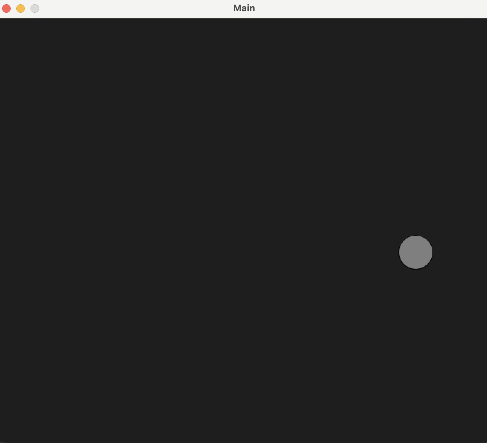

### Overview
- this is a small bouncy ball project to work with vectors (lin alg vectors), velocity and processing

> this is a Screenshot from the programm

### Resources
[Nature of Code ~ Shiffman](https://www.amazon.de/Nature-Code-Simulating-Natural-Processing/dp/0985930802)
